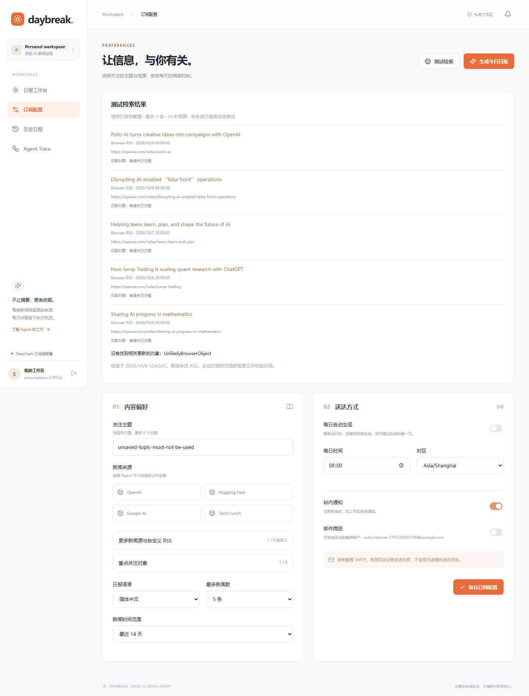

# Daybreak 订阅增强验收

执行日期：2026-10-09，Windows / Python 3.13 / Node 24。本目录是新的验收记录；原 `evidence/backend-tests.xml`、`browser-tests.json`、`live-e2e.json`、日报与页面截图没有覆盖。

## 实际执行结果

| 检查 | 结果 | 证据 |
|---|---|---|
| 完整后端回归（含原56项与新增31项） | 87 passed | [JUnit](backend-tests.xml) |
| 浏览器回归（原2项 + 新增2项） | 4 passed，包括真实RSS场景，无跳过 | [Playwright](browser-tests.json) |
| Python 静态检查 | `ruff check backend scripts` 通过 | 本次实际执行 |
| 前端类型与生产构建 | `npm run typecheck`、`npm run build` 通过 | 本次实际执行 |
| URL与网络安全 | HTTPS/443、凭据、私网/元数据、混合DNS、DNS截止、TLS IP固定、重定向、压缩、超大响应、慢流截止、URL缓存/用户限流 | 后端测试 |
| 用户权限 | 自定义源跨用户查看/启停/删除/检测隔离，关注对象独立保存，删除源不能被选回，抓取前校验撤销 | 后端测试 |
| 关注对象 | 名称与别名改变检索结果；对象进入Agent State/get_preferences；未匹配对象如实返回 | 后端测试 |
| 无推送副作用 | 预览不创建runs/trace/articles/digests/deliveries/notifications；真实预览数据库计数也为0 | 后端与真实网络证据 |

浏览器首次运行出现测试定位器与 Next.js 隐藏 route announcer 的 `role=alert` 冲突，修正为组件内定位后，完整4项重跑通过。没有用模拟RSS替换失败来源。

## 真实新闻源

[真实HTTPS/API检测](sources-live.json) 在一次性数据库运行，不调用LLM，不发送推送：

- OpenAI：成功，80条有效条目。
- TechCrunch AI：成功，20条有效条目。
- Microsoft Research：成功，10条有效条目；本地实例已经据实记录为可启用候选预置源。
- Anthropic候选RSS：HTTP 404，保留失败原因且禁用。
- Meta AI、arXiv：本次网络超时，禁用；这不证明发布方永久不可用。
- 原Hugging Face、Google AI：本次连接超时；保留原有预置配置并显示错误。
- 自定义 Microsoft Research RSS：真实解析成功，以关注对象/别名检索得到4条候选，均标出匹配对象。正式任务/日报/投递/通知计数均为0。
- 将 OpenAI HTML首页当作RSS提交：真实请求后明确返回无效RSS/XML错误，保存为禁用状态。
- 浏览器另一次真实添加OpenAI RSS、启停、删除与已保存配置预览成功。

[手机订阅配置截图](subscription-mobile.png)

## 代码变更范围

- `backend/app/schemas.py`、`db.py`：关注对象、来源参数、兼容旧偏好的增量SQLite表。
- `backend/app/services/news.py`、新增 `subscriptions.py`：公开HTTPS访问边界、源检测/缓存/限流、用户目录、别名检索与状态。
- `backend/app/api.py`：来源管理与只读预览API，保存配置时校验来源所有权与可用状态。
- `backend/app/tools/registry.py`、`agent/graph.py`：原搜索/抓取工具接入用户来源与对象，State增加偏好；保持原model↔tools拓扑及10工具。
- `frontend/app/page.tsx`、`types.ts`、`globals.css`、新增 `SubscriptionExtras.tsx`：折叠源卡片、对象编辑、检索按钮/结果，保留Daybreak视觉。
- `backend/tests/test_subscriptions.py`、`frontend/tests/subscriptions.spec.ts`：功能/安全/副作用及浏览器验收；现有浏览器配置和截图支持独立输出目录。
- `scripts/verify_subscription_sources.py`：可复现真实RSS/API验收，拒绝覆盖已有输出。
- `README.md`、`docs/security.md`、本目录：使用方法、边界与真实验收记录。

## 已知限制与未验证事项

- 本次没有重新调用真实DeepSeek。原7轮模型/11次工具的历史证据保留；新增对象到模型协议/State的连接已离线测试，新偏好下真实模型的摘要质量没有重新评测。
- 预览是RSS标题/摘要的关键词和别名匹配，不调用LLM、不抓文章全文。正式日报仍需调用原抓取/引用验证工具，逐字证据规则与推送权限回归通过。
- 25秒是网络搜索预算；SQLite、本地解析与HTTP处理可能有少量额外耗时。每URL60秒缓存同时复用成功和失败，重试可能需要等缓存过期。
- 自定义仅HTTPS，不支持HTTP源、需登录的源或压缩响应。最多8自定义/12已订阅来源、8对象、6别名；超限明确拒绝。自定义源与预置源指向相同URL是允许的，结果按规范化文章URL去重。
- 用户须至少保留一个来源；唯一订阅来源不能直接删/禁用，先选择另一个来源再保存。
- 新部署的新增候选预置源默认禁用，须在页面检测成功。检测状态存本地数据库，公开证据不会自动导入其他环境。
- CI依赖外部RSS的浏览器场景需 `LIVE_RSS_BROWSER=1`；没有推送本次改动，也没有声称运行新的GitHub Actions。
- 本次没有重跑外部SMTP邮件、Docker部署或跨平台浏览器；既有SMTP协议、调度与幂等测试已包含在87项回归中。
